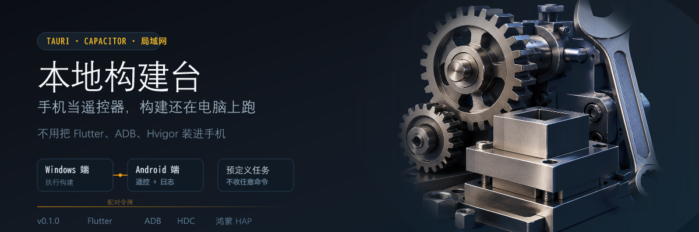

<p align="center">
  
</p>

<p align="center">
  <a href="#架构"></a>
  <a href="#安全边界"></a>
  <a href="./LICENSE"></a>
</p>

写移动端项目时，构建总要把人按回电脑前：改完想在真机上看一眼，得走过去敲命令。

**BuildBench（本地构建台）** 把这件事拆成两半——Windows 端继续当唯一的构建执行端，手机只当遥控器。躺沙发上也能触发构建、安装、测试，日志实时回传到手机上。

---

## 架构

```text
Windows 桌面端（Tauri）              Android 遥控端（Capacitor）
  执行 Flutter / ADB / HDC / Hvigor  ──局域网──▶  触发任务 · 看日志 · 看设备
```

- Windows 端是**唯一**的构建执行端，负责调用 Flutter、ADB、HDC 与 Hvigor。
- Android 端只是局域网遥控器，不在手机上安装任何构建工具链。
- 两端通过本机地址、固定端口（默认 `48484`）与随机配对令牌连接。

---

## 能做什么

**Windows 桌面端**

- 双栏操作页：设备卡片、构建模式、实时日志
- 保存项目目录与 Flutter / ADB / HDC 路径
- Android APK 构建与安装
- Flutter 测试、清理、Doctor 检查
- 鸿蒙 HAP 构建与 HDC 安装
- 展示手机连接地址、配对令牌与远程服务状态
- 工具路径自动探测（PATH / `ANDROID_HOME` / 常见目录）
- 顶栏显示手机连接状态与工具状态
- 打包 Windows NSIS 安装程序

**Android 遥控端**

- 连接页，安全保存电脑地址与配对令牌
- 展示 Windows 端在线状态、项目名与构建状态
- 展示 Android / 鸿蒙设备状态
- 触发上述全部任务，并轮询展示实时构建日志
- 展示电脑端 Flutter / ADB / HDC 工具状态

---

## 安全边界

远程接口只开放预定义任务，**不接受任意命令文本**。所有受保护请求都必须携带 `X-BuildBench-Token`：

```text
GET  /api/status
GET  /api/devices
GET  /api/logs?after={id}
POST /api/tasks/{action}    body: { "mode": "debug" | "release" }
```

允许的 action（白名单，不可扩展）：

```text
android_build     android_install
flutter_test      flutter_clean      flutter_doctor
harmony_build     harmony_install
```

未配对的设备无法调用任何任务。

---

## 本地运行

```powershell
cd BuildBench
npm install
npm run dev            # Tauri 桌面端开发
npm run build          # 前端类型检查 + 生产构建
npm run tauri build    # 打包 Windows 安装程序
```

### Android 遥控端

```powershell
cd BuildBench/android-client
npm install
npm run build
npm run android:sync

$env:ANDROID_HOME = "C:\Android\Sdk"
$env:ANDROID_SDK_ROOT = "C:\Android\Sdk"
Set-Location android
.\gradlew.bat assembleDebug
```

---

## 技术栈

- **桌面端**：Tauri 2 · Rust · React 18 · TypeScript · Vite
- **遥控端**：React + Vite + Capacitor（Android）
- **构建工具链**：Flutter · Android SDK（ADB）· HarmonyOS SDK（HDC）

---

## 目录

```text
BuildBench/                  Tauri 桌面端
├── src/                     React 界面
├── src-tauri/               Rust 后端与任务执行
└── android-client/          Capacitor 遥控端
BuildBench-Redesign.design/  设计稿
```

---

## 许可证

[MIT](./LICENSE)
